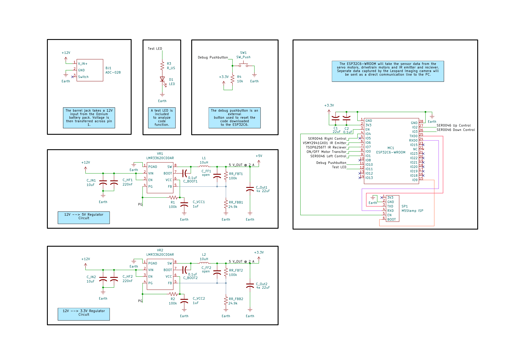

---
Central Controller and Power Distribution
---

## Overview

This schematic is design to support the Pipe Blockage and leak detection device being developed by Team 310 in EGR 314. The functionality of this subsystem revolves around power distribution to the other subsystem, as well as in taking in sensor input data and analyzing it via the ESP32C6-WROOM microcontroller. 

**Figure 01:** Central Controller and Power Distribution Schematic Components

## Resouces

The schematic as a PDF download is available [*here*](ExampleSchematic.pdf), and the Zip folder of the project [*here*](dummyZip.zip).
